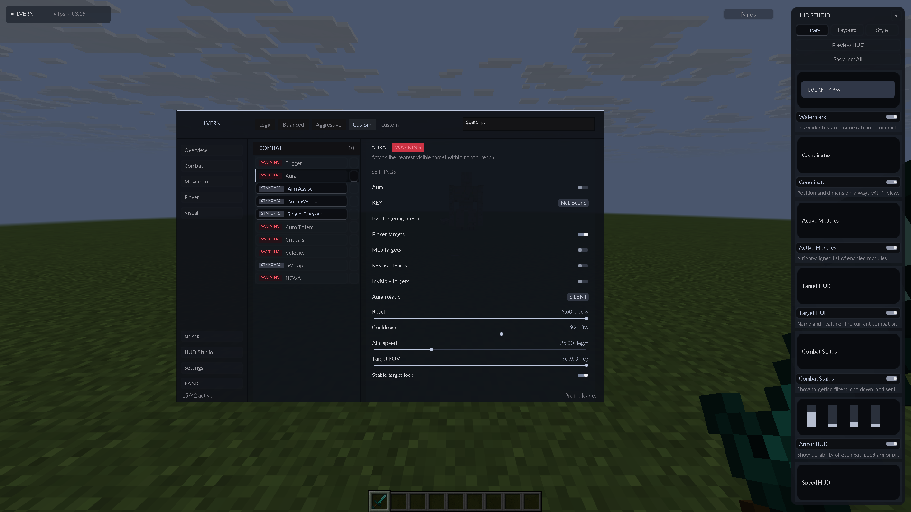
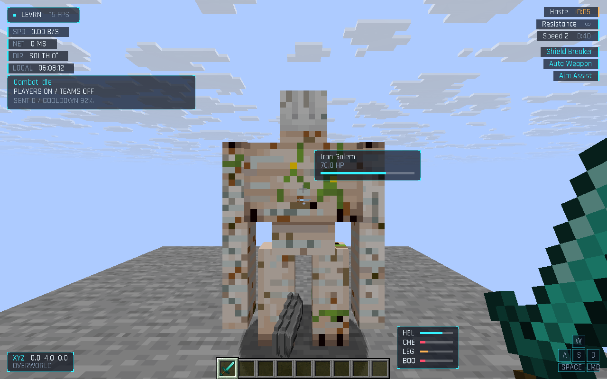
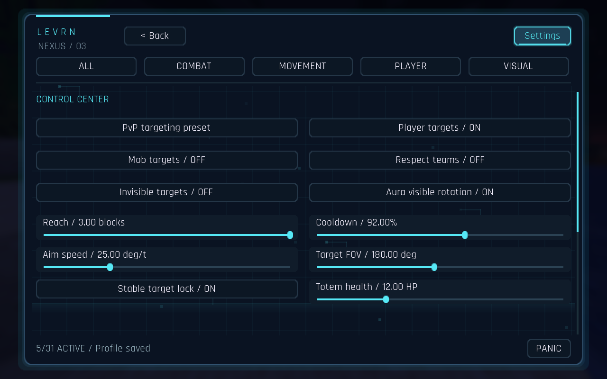
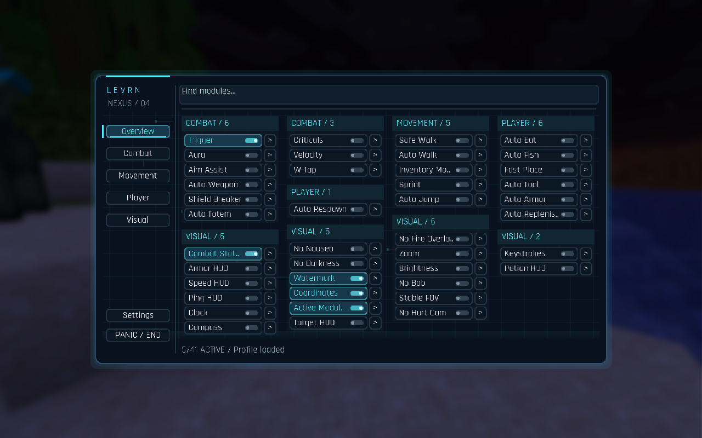
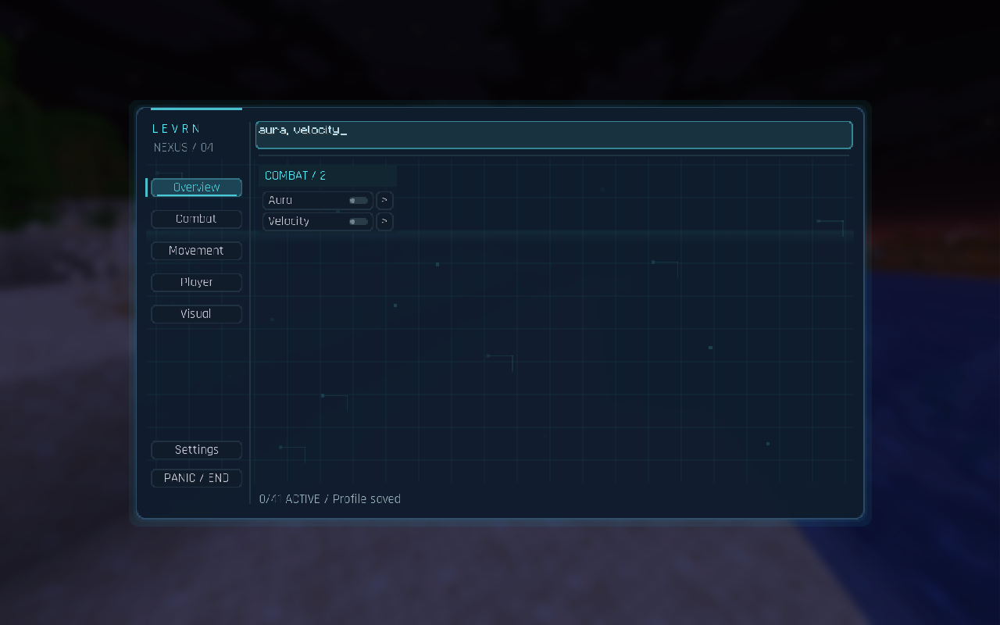

# Levrn

An original modular Minecraft **Java Edition 1.21.11** client built with Fabric and Java 21. LVERN Nova adopts the uploaded client source as its baseline and remains a prerelease alpha.

**Windows download:** [Levrn.exe](https://github.com/PeteyTB/Themanwhoclosedthedoor/raw/refs/heads/main/downloads/Levrn-0.5.0-alpha-windows-x64.exe) · [Alpha release and installation notes](https://github.com/PeteyTB/Themanwhoclosedthedoor/releases/tag/v0.5.0-alpha)

## Version 0.5: LVERN Nova and the reference interface

The supplied **levrn-nova-complete.zip** is the new source baseline: **42 modules**, the supplied combat behavior, local adaptive matrices, presets and HUD components. Fixed Nova activation, delayed hit observations, per-server model persistence and bounded setting updates. This is local adaptive learning, with transfer between locally saved server profiles; no global learning service is included.

The reference interface now has two views: a compact sidebar/list/inspector workspace and floating category panels. Both share translucent charcoal surfaces, WARNING/STANDARD badges, animated switches, smooth scrolling and an independent **HUD Studio** dock. Its Library controls the real HUD modules; Layouts applies HUD presets; Style changes theme, density and motion. Oversampled Lato typography replaces the previous display font. Keep the project's LVERN branding and real module inventory.



[Panels view](docs/screenshots/nova-panels.png) · [Nova inspector](docs/screenshots/nova-inspector.png) · [release changes and verification](docs/NOVA_RELEASE.md)

**Upgrade:** close Minecraft and the launcher, run the new **Levrn.exe**, then select **LVERN Nova 1.21.11** in the official launcher. The executable includes the current client and Fabric components. It backs up older JARs identified by mod ID in the managed and default mods folders, installs one managed `levrn.jar`, and preserves settings, worlds and unrelated mods. Use this fresh executable instead of the older executable included in the source upload.

Nova remains opt-in. Public-server compatibility is unverified; local test results do not establish anti-cheat acceptance. The Windows executable is cross-compiled and has not been run on Windows.

## Version 0.4.1 (historical): supplied HUD and input synchronization

The user's HUD code is adapted to Minecraft 1.21.11: cyan bracketed panels, an animated watermark, compact info rows, animated durability bars, potion timers and glowing keystrokes. All HUD text uses one oversampled TrueType font. Existing visual toggles remain available. [HUD screenshot](docs/screenshots/hud-world.png) · [implementation and verification](docs/HUD_AND_INPUT_FIX.md).



Silent Aura now prepares rotation **before vanilla physics**, with matching native movement directions. Sprint/W Tap update native sprint input; Criticals and Safe Walk use native jump/sneak input. That release stopped gameplay modules after repeated corrections; the adopted Nova source instead pauses briefly and feeds corrections to the model while preserving the selected modules. Disconnect details and packet-type history stay locally in `config/levrn/last-disconnect.properties`. A server-specific rejection is still unverified.

## Version 0.4: compact workspace, combat sequencing and ten more modules

**41 implemented modules.** [Packet-path comparison, module scope and source evidence](docs/NETWORK_MODULE_REVIEW.md).

- Smaller sidebar interface, independent of Minecraft GUI scale. The standard overview fits all 41 modules without scrolling; category and module inspectors remain available. Settings → Interface size controls density.
- Aura defaults to **Silent** rotation: the camera stays free while vanilla sends the prepared server rotation in its normal movement update. Visible and manual-aim modes are available. Removed the extra pre-attack rotation packet; paced cursor transactions now send one inventory click at a time. Server corrections pause automation and clear stale targeting state.
- New modules: **Criticals, Velocity, W Tap, Safe Walk, Auto Walk, Inventory Move, Auto Eat, Auto Fish, Fast Place, No Fire Overlay**. All start disabled. Criticals uses real jumping/descending; Velocity adjusts incoming entity knockback and preserves teleport corrections. These names do not imply verified server bypasses.
- Existing animations, sliders and per-module keybindings remain. Search matches names, IDs and categories.

**Close Minecraft before upgrading.** Version 0.4 requires startup hooks: run the installer and launch the Levrn Fabric profile. Live attachment cannot install those hooks into an already-running game.

## Version 0.3: motion and inventory integration

**31 implemented modules.** The newest Kuro and Prestige uploads were inspected internally. The new Prestige is a **1.21.1 engine preview**, not a drop-in upgrade for 1.21.11. See the [evidence and subsystem decisions](docs/KURO_PRESTIGE_REVIEW.md).

- Spring-driven opening/closing, page fades, smooth scrolling, sliding toggle knobs, hover lighting and a traveling category indicator. Circuit/constellation decoration, scan lighting, antialiased panel corners and animated notifications complete the original interface.
- Drag the Levrn header to reposition the panel. Position, reduced motion and animation speed persist. Settings now use real drag/keyboard sliders; every module has a binding in Minecraft Controls.
- Auto Armor upgrades worn armor using base armor, toughness and durability, with removal checks and Elytra preservation. New Auto Replenish refills matching low/depleted hotbar stacks. A shared action budget coordinates inventory and slot changes with combat.
- Stable target selection reduces switching between similarly distant eligible targets. Shield Breaker considers the blocking target's facing direction. Existing weapon cooldown and targeting controls remain available.

[Watch the actual Minecraft motion preview](docs/screenshots/workspace-motion.mp4)



## Version 0.2: internal review and redesign

Version 0.2 introduced **30 implemented modules** and a rebuilt multi-category workspace with continuous scrolling, a module inspector, Nova theme, and openly licensed Rajdhani typography. Global search supports several names at once: `aura, sprint`. Selecting a category spreads its modules across the available columns. See [internal code review and complete readable module inventory](docs/INTERNAL_REVIEW.md) for what was recovered from the uploads and which features are still missing.





**For existing users whose combat did not target players:** open **Settings → Combat defaults**, or the Aura/Trigger inspector, and choose **PvP targeting preset**. Existing saved filters are preserved on upgrade. The preset enables player targets and disables shared scoreboard-team filtering. Combat diagnostics show filters, cooldown/alignment state and sent attacks. Attacks use eye-to-hitbox range and the selected rotation mode; cooldown follows the held item, including swords and axes. This fixes identifiable client-side causes; damage delivery on PvP Legacy remains unverified.

New modules: Aim Assist, Auto Weapon, Shield Breaker, Auto Totem, Auto Armor (expanded in 0.3), vanilla Auto Jump, Auto Respawn, No Bob, Stable FOV, No Hurt Cam, No Nausea, No Darkness, Combat Status, Armor HUD, Speed HUD, Ping HUD, Clock, Compass, Keystrokes, Potion HUD. New combat modules start disabled.

## LiquidBounce settings research

The official LiquidLauncher and LiquidBounce source trees were inspected. LiquidLauncher is Rust/Tauri; the actual Kotlin gameplay settings tree is in LiquidBounce. The matching **v0.37.0 / Minecraft 1.21.11** source contains 232 Module*.kt files and 1,721 directly named setting declarations, with more settings inherited or nested dynamically. See the [linked source and module/settings inventory](docs/LIQUIDBOUNCE_REVIEW.md). This is a reference inventory, not 232 modules already integrated into Levrn.

## Current implementation

- Searchable category/card interface with keyboard-accessible controls and eight themes, including the reference-style neutral Nova palette.
- Trigger and nearest-target Aura with attack cooldown, visibility, team, creative, and range checks. New profiles include player targets; existing profiles preserve their filters. The Settings PvP preset can enable them. Both modules start disabled.
- Sprint, hotbar Auto Tool, toggle Zoom, and vanilla maximum Brightness. Tool, FOV, brightness, and owned sprint changes are restored when deactivated or leaving the world.
- Watermark/FPS, coordinates/dimension, active module list, and crosshair target health HUD.
- An atomic local profile with strict validation and transactional loading; a broken profile is reported without replacing the original file on startup.
- A panic key that disables every module. Module mutations run on the Minecraft client thread.

Controls: **Right Shift** opens the menu, **C** toggles zoom, **End** disables all modules. These mappings and individual module bindings can be changed in Minecraft's Controls menu. Settings include attack range, player targeting, zoom FOV, themes, save/reload, and reset. The profile lives at `config/levrn/profile.properties` in the game directory.

## Windows executable

`build/dist/Levrn.exe` is the Windows x64 installer/attachment tool. The executable bundles the built Levrn client, official Fabric Installer 1.1.2, Fabric API 0.141.6+1.21.11, and the Java attachment agent. It discovers an existing Java 21 runtime in `JAVA_HOME`, `PATH`, the Minecraft runtime directory, or common Windows JDK directories. Java itself is not bundled. Version 0.4 requires startup installation and restart; the diagnostic `--list` command needs a Java 21 JDK with `jdk.attach`.

1. Close Minecraft and the official Minecraft Launcher.
2. Run `Levrn.exe`. First installation needs internet access for the official Fabric Loader libraries.
3. Open the Minecraft Launcher, select **LVERN Nova 1.21.11**, and press **Play**. Normal Minecraft authentication stays with the official launcher.

The installer writes a dedicated game directory at `%APPDATA%\.minecraft\levrn\1.21.11`, adds a separate launcher profile, and backs up launcher profile files before updates. Version 0.5 detects Levrn by its Fabric mod ID, backs up previous copies in the managed/default mods folders, and installs one stable managed `mods/levrn.jar`; custom JVM profile settings are preserved. Existing game directories and mods are preserved. It supports both normal and Microsoft Store launcher profile files. Alternative launcher directories can be supplied with `--minecraft-dir`.

```powershell
.\Levrn.exe --java "C:\Program Files\Eclipse Adoptium\jdk-21\bin\java.exe"
.\Levrn.exe --minecraft-dir "D:\Minecraft"
```

This follows the requested automatic Fabric installation option. It does not attach Fabric to an already-running vanilla game; start the installed profile to use Levrn.

### Live attachment

Version 0.4 uses startup mixins for movement sequencing, velocity, edge protection and rendering. The attachment agent rejects late installation with an explicit restart instruction. Use the executable's normal installation mode, close Minecraft, then launch the Levrn Fabric profile. `--list` can still list running JVMs; `--attach` cannot add these hooks to a game that is already running. Earlier releases' attachment behavior is historical and does not apply to 0.4.

### Rebuild the executable

Install a Java 21 JDK, Go 1.23+, and Python 3. Set `JAVA_HOME` and `LEVRN_GO` as needed. On this Linux cloud machine:

```sh
python3 scripts/gradle-cloud.py --no-daemon build
python3 scripts/package.py
python3 scripts/test-attach.py
```

`package.py` verifies pinned dependency checksums, compiles the Java controller/agent, runs Go installer tests, then builds Windows x64 and Linux test-host executables. The generated payload files stay in ignored `launcher/payload/`. The Windows executable is unsigned.

## Client development

Use a **Java 21 JDK** (a JRE alone is insufficient).

```sh
./gradlew build
./gradlew runClient
```

The intended distributable is `build/libs/levrn-0.5.0-alpha.jar`. Install Fabric Loader and Fabric API for Minecraft 1.21.11 and put the built JAR in the game instance's `mods` directory. Do not use the `-sources.jar`.

In the managed cloud environment:

```sh
bash scripts/setup-cloud.sh
python3 scripts/gradle-cloud.py runClient
```

The setup helper installs a checksum-verified JDK under `/workspace/.tools`. The Gradle helper uses inherited session proxy settings without persisting credentials. Gradle's wrapper JAR and distribution checksums were verified against Gradle's published checksums. Each cloud task is already isolated; use the existing checkout and do not create a worktree unless explicitly requested.

## Verification status

`bash scripts/test-core.sh` exercises the actual pure-Java module registry and profile implementation without Minecraft downloads. `./gradlew check` also runs these checks once Fabric dependencies resolve.

The full Minecraft 1.21.11 Gradle build now passes, including all **98 core behavioral checks** and **16 Nova model checks**, and produces the remapped client JAR. Internet access is available; the cloud Gradle helper uses the environment's trusted Java CA store to preserve proxy TLS verification. The 1.21.11 button-rendering API mismatch and the standalone test source-set configuration were corrected during compilation.

Go installer checks pass for profile preservation, idempotent updates, malformed/conflicting input, recoverable backups, version checks, and embedded payload extraction. A real end-to-end Fabric installation ran through the Linux build in an isolated temporary Minecraft directory, installed the official libraries and both mod JARs, and preserved the existing profile. Two real JVM attachment rejection tests cover unsupported and agent-disabled targets; 0.4 additionally rejects late installation of its required startup hooks.

The Windows PE executable was cross-compiled; **it has not been run on Windows**. The redesigned UI, custom font and animations have been rendered in the actual development client on an isolated software display. Settings, numeric sliders, module toggles and multi-module search were exercised with real input; slider changes were confirmed in the saved profile. Controlled local gameplay validation is described below. Public-server anti-cheat compatibility remains unverified. This remains a prerelease alpha.

The optional `runClientGameTest` task starts an isolated integrated-server scenario covering target filters, server damage, armor, totems and replenishment. Test classes are excluded from release JARs. Both cloud attempts (including a retry with bounded Java worker threads) timed out during world loading, before any gameplay assertions; neither is a passing server test.

`runLocalSmoke` exercises an ordinary client and integrated server, bypassing the older test framework's world-loading barrier. Its test mod and automatic world creation are opt-in and excluded from the packaged client. The run passed: target filtering, Silent Aura with an unchanged backwards-facing camera, Trigger damage, paced worn-armor upgrades, replenishment conserving 67 items, incoming knockback scaling, real-jump critical attacks, and Safe Walk with Auto Walk. The updated run also passes moving Aura + W Tap + Sprint with matching native input, the uploaded correction handling with Nova observations, actual disconnect-report persistence, and Nova profile persistence. Startup mixin auditing also completed. This proves controlled local interactions, not server-specific anti-cheat acceptance.

## Gameplay acceptance checks

1. Launch the exact 1.21.11 development client. Open a singleplayer world; open Right Shift, search modules, switch categories and themes, resize the window, and change GUI scale.
2. Toggle Sprint and Auto Tool, mine with multiple hotbar tools, and verify the prior slot restores without overriding a manual slot change.
3. Enable/disable Zoom and Brightness, disconnect and reconnect, and verify original settings restore.
4. Enable Trigger/Aura separately and together around mobs. Verify cooldown, visibility, target filters, all rotation modes and camera restoration. Verify player interactions only in an agreed test world; valid packet formatting does not guarantee acceptance by server anti-cheat.
5. Change settings, restart, and verify persistence. Press End and confirm every module stops. Test profile reload failures with a copy of the profile.
6. Confirm HUD elements respect F1 and visually inspect placement at small and large GUI scales.

No anti-cheat bypass or ban-prevention claim has been tested. Commercial licensing, billing, a signed updater, advanced movement/render modules, HUD dragging and performance profiling remain future work. See [internal findings and parity](docs/INTERNAL_REVIEW.md) and [LiquidBounce settings](docs/LIQUIDBOUNCE_REVIEW.md) for source evidence and remaining work.
