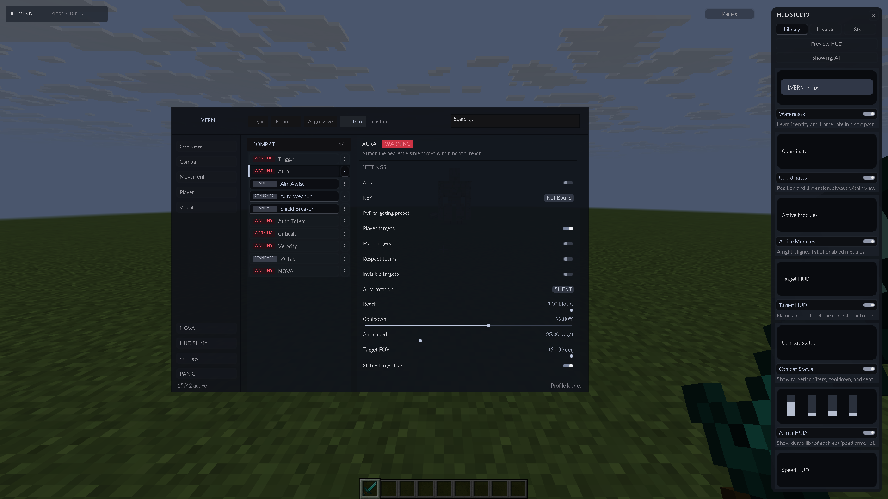
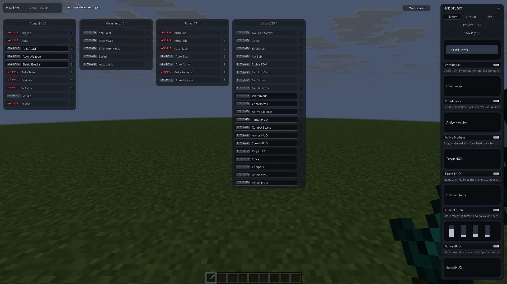
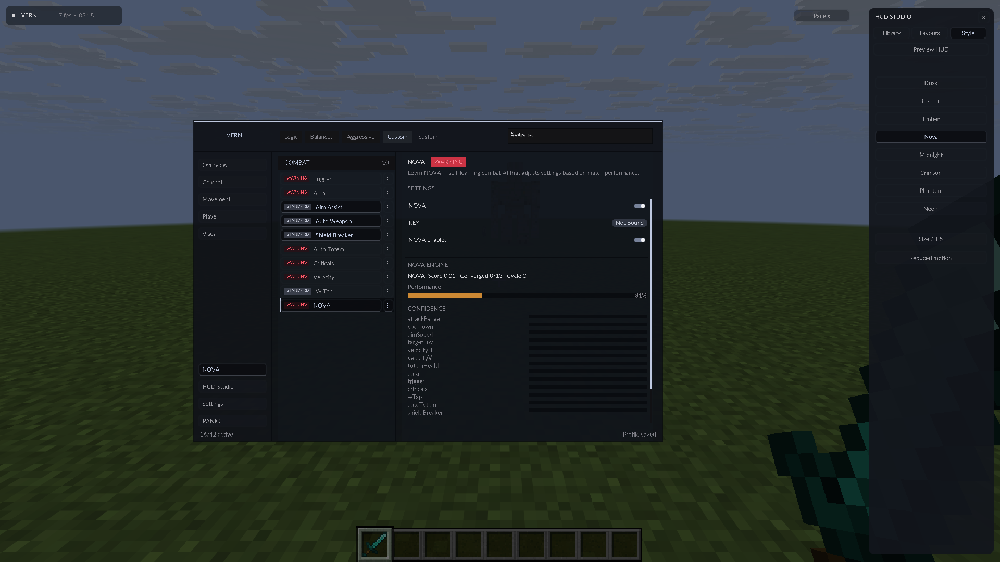

# LVERN Nova 0.5.0-alpha

This release adopts the user's `levrn-nova-complete.zip` source as the new baseline. Archive SHA-256: `a6bdea6843c293dbf26d802a9444db6b8c96d9acdfd91f426a800c81397e630a`. Its 42-module registry, combat implementation, action budget, presets and HUD components are retained, with the fixes below. Uploaded executables were inspected as data and were not executed.

## Installation fixes

The source upload's executables still embedded the older 0.4.1 build. Its batch script installed a second filename beside the installer's stable `levrn.jar`, which could cause duplicate Fabric mod IDs. The new executable is rebuilt from this release's source and embeds the matching client, official Fabric installer and checksum-pinned Fabric API. The source batch script now builds and packages the executable before running it, and stops on failure.

Close Minecraft and the launcher before upgrading. Run **Levrn.exe**, then select **LVERN Nova 1.21.11** in the official launcher. The installer examines `fabric.mod.json` in JARs in the managed instance and the default Minecraft mods folder. It backs up old mod ID `levrn` copies, installs one managed `mods/levrn.jar`, and removes the alternate Levrn filenames. It preserves unrelated mods, worlds, configuration, profile ID and custom launcher arguments. Backups have a `.levrn-backup-…` suffix. The existing `config/levrn` directory is preserved.

Minecraft Java 1.21.11 and Java 21 are required. Fabric's hooks load at startup; the executable's normal install mode supplies Fabric automatically. Live attachment cannot add these startup hooks to an already running vanilla game.

## Nova fixes

- The module, configuration and engine now share one enabled state. Panic disables the real engine. Repeated tick synchronization does not reset learning or encounters.
- Hit observations wait for server health updates rather than clearing the target in the attack tick. Observations expire after a bounded 20-tick window.
- Stable entered server addresses key profiles; singleplayer has its own stable key. Model weights, momentum, confidence, observations, encounter counts and play time are captured before autosave, disconnect and shutdown.
- Restored values reject nonfinite numbers. Learned zero weights persist. Transfer uses a true weighted average across local profiles. Learning-rate settings affect bounded updates.
- Encounters complete on kills, deaths or idle, and long fights evaluate at intervals. Successful adjustments schedule a debounced configuration save and mark the combat preset Custom. Disabling Nova finalizes observation accounting without changing settings.
- The uploaded correction behavior is retained: a brief pause, stale-target cleanup and correction observations. It does not restore the old release's forced module shutdown.

Nova is a **local adaptive heuristic** using the supplied weight matrices and encounter signals. It does not contact a global model service. Scores and settings changes are not evidence of improved results or server bypasses. Its evaluation loops have fixed-size settings/signal bounds; there is no additional world-wide entity polling loop.

## Reference interface

The default workspace follows the supplied sidebar/module-list/settings-inspector reference. **Panels** switches to the floating category layout; **Workspace** returns. Both retain LVERN branding, actual modules and settings, translucent charcoal panels, compact severity badges, animated switches and smooth scrolling. No placeholder modules are added to imitate the reference's larger module count.

The separate **HUD Studio** dock contains Library toggles for the actual HUD elements, an enabled-only filter, scrollable preview cards, three HUD layout presets, theme/size/motion controls and a Preview HUD action. The sidebar button shows or hides the dock. Preview cards label inactive elements; numeric clock, FPS and armor examples use current client data. Other cards are labeled representations rather than complete miniature renders of every HUD element.

Interface and HUD text use oversampled Lato TrueType resources with their OFL license included. Minecraft's standard item and world textures retain their normal pixel style.

## Verification

- Full Java 21 / Minecraft 1.21.11 Gradle build: **98 core checks and 16 Nova checks**. Model checks exercise real bounded updates, enable synchronization, persistence, finite-value guards, zero weights, transfer averaging and encounter accounting.
- A complete Fabric installation through the freshly packaged Linux test-host executable verified the exact new JAR, removal and backups of both old copies, and preservation of custom profiles, JVM arguments, configuration and a world marker. The cloud test used the environment's trusted Java CA store with TLS verification enabled.
- Go installer checks cover renamed and batch-installed Levrn JARs, default-folder migration, backups, unrelated mods, profile preservation and repeated installation.
- An ordinary Minecraft client and isolated integrated server passed filters, Silent Aura damage with an unchanged camera, Trigger, paced worn-armor upgrades, refill with 67 conserved items, velocity scaling, native jump criticals, edge protection, Auto Walk, moving Aura + W Tap + Sprint, Nova encounter observations, saved profile reload and disconnect diagnostics. Production JARs exclude the local test harness.
- Both interface views and HUD Studio were inspected in the real Minecraft development client on an isolated software display. Release images are captures from that client.

The Windows x64 executable is cross-compiled and unsigned; it has not been run on Windows. Public-server anti-cheat compatibility remains unverified. Valid local packet behavior does not establish acceptance on a particular server.
