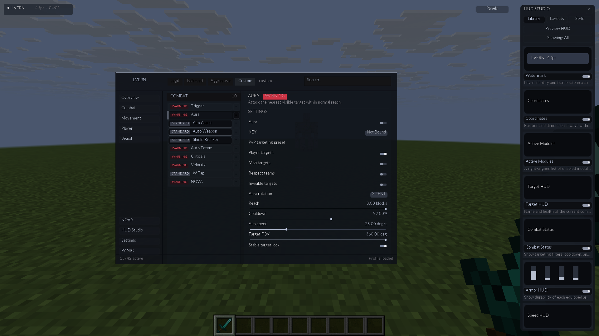
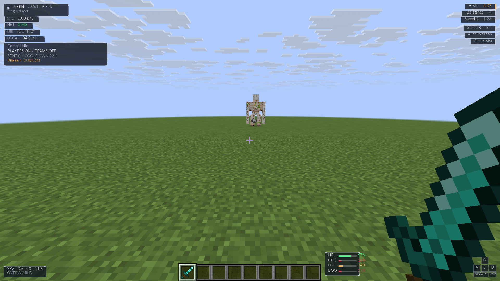

# UI clarity update — 0.5.1-alpha

The previous interface used a 7.5-unit font inside a 1.5× layout transform: approximately 11.25 physical pixels per em. Badges applied another 0.7× transform, reducing them to approximately 7.875 pixels. Increasing the font atlas oversampling did not make that small final text larger or align its transformed origin with the screen grid.

The new renderer separates layout density from text rasterization. Each supported text size has a TrueType strike rasterized at its final integer pixel size. The drawing path converts the current pose into framebuffer coordinates, snaps the origin to a pixel, and removes the layout/Minecraft GUI transform from the glyph scale. Antialiased glyph coverage is retained, with one atlas pixel mapped to one framebuffer pixel.

At the existing default 1.5 interface size:

| Element | Final font size |
| --- | --- |
| Labels, descriptions and settings | 13 px |
| WARNING / STANDARD badges | 10 px |
| In-game HUD | 15 px |

Interface size still controls spacing and panel dimensions. Text selects an integer strike as density changes; badges use their own strike rather than shrinking the label font. Minimum text sizes keep small layouts legible. The module column expands slightly inside the same workspace footprint, and inactive-label contrast increases. HUD panels are slightly more opaque and secondary HUD text is brighter to remain legible against bright skies.

Search keeps Minecraft's editing, keyboard navigation and clipboard model. Its custom drawing, mouse hit testing, horizontal clipping and selection use the same font metrics as the displayed text. Cursor/selection state survives the search-driven widget refresh, and typing no longer restarts the page fade. The old search rendered a custom font while measuring plain text with the default Minecraft font.

Validation uses the full Gradle build and the existing 98 core / 16 Nova checks, plus actual Minecraft rendering at 1920×1080, multiple Minecraft GUI scales and an intermediate interface density. The static Combat-header region (1,596 pixels) is pixel-identical between GUI scales 2 and 3 at native 1080p. Interactive checks cover search input, mouse placement, selection replacement and the HUD Studio. Release captures show the running development client; the software display's FPS is not a hardware performance benchmark.

Installation is unchanged: close Minecraft and the launcher, run the new executable, then select **LVERN Nova 1.21.11**. Older managed Levrn JARs are backed up and replaced; configuration and Nova profiles are preserved. The Windows x64 executable is cross-compiled and unsigned; Windows execution remains unverified.
